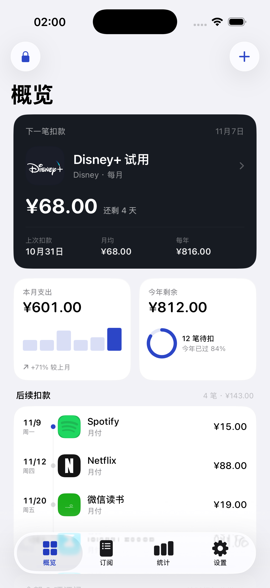
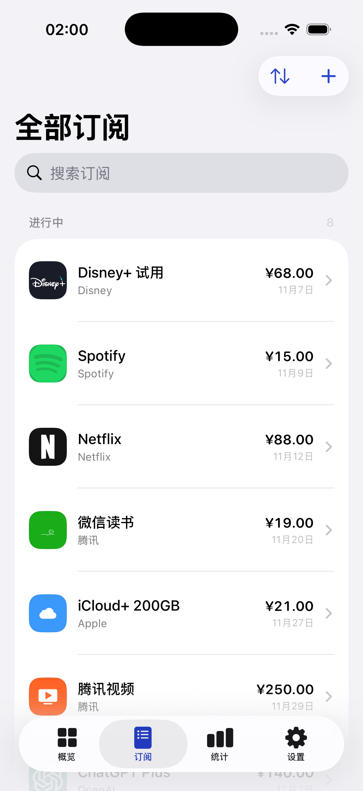
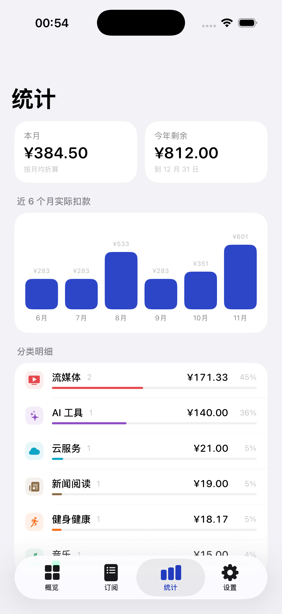

# W Sub

一个用原生 Swift 写的订阅管理 App：数据是一个**加密文件**，放在你自己选的文件夹里；用密码或 Face ID 打开。没有账号、没有服务器、没有第三方 SDK。

iOS 18+（iOS 26 上使用系统液态玻璃 chrome），Swift 6 严格并发。

| 首页（时间线 + 卡片） | 全部订阅 | 统计 |
|---|---|---|
|  |  |  |

## 现在能跑

```bash
open apps/ios/WSubscription.xcodeproj      # 选 iPhone 模拟器，⌘R
```

调试期启动参数（仅 Debug 编译，Release 不含这段代码）：

| 参数 | 作用 |
|---|---|
| `-ws-demo` | 用示例数据在临时目录建一个保险箱并自动解锁 |
| `-ws-tab library` | 直接打开某个标签页（`dashboard` / `library` / `stats` / `settings`） |
| `-ws-lock` | 建库后立刻锁定，用来看锁屏；密码 `demo-pass` |

不加参数就是真实首次启动：选文件夹 → 设密码 → 存恢复码 → 可选 Face ID。

```bash
cd packages/WSubscriptionKit && swift test --disable-sandbox    # 51 个测试
```

## 界面

原则只有一条：**内容优先，不要装饰**。

- 全屏纯色分组背景，没有任何整屏渐变或光斑。
- 玻璃只出现在系统 chrome：标签栏、导航栏、菜单、弹层、表单。内容区一律实色白卡 + 0.5px 描边。
- **概览页是仪表盘，不是清单**，四块内容各自承担一件事：
  1. **下一笔**（深色主卡）：品牌图标 + 金额 + 「还剩几天」+ 上次扣款 / 月均 / 每年。
  2. **两张较高的数据卡并排**：本月支出（近 6 个月小柱状 + 环比）与今年剩余（年进度环 + 待扣笔数）。
  3. **后续扣款时间轴**：左侧日期轨 + 竖线连接，右侧图标与金额，只列未来 4 笔。
  4. 底部一行入口跳到订阅页。
- **订阅页是清单**（系统分组列表 + 搜索 + 按时间/分类切换），和概览页刻意保持两种形态，不重复。
- 设置页与引导页只留控件和一句话，不写说明文案。
- 详情页有**扣款时间线**：过去两笔 + 未来三笔。

## 图标

内置 **177 个订阅服务**，覆盖流媒体、音乐、软件、云存储、AI、健身、资讯、游戏、教育、生活会员、网络安全、通讯运营商。

图标分两种排布，都按品牌自己的样子来：

- **全彩标（66 个）**：直接铺满圆角方块，就是各家 App 图标的样子。来源 [dashboard-icons](https://github.com/homarr-labs/dashboard-icons)（Netflix、Disney+、Hulu、Prime Video、Spotify、YouTube、Notion、Figma、1Password、Xbox、Steam…），Iconify `logos` 补位。
- **单色标（89 个）**：用**品牌色做底 + 白色标志**，效果等同深色 App 图标（腾讯视频橙底、微信读书绿底、iCloud 蓝底）。
- 剩下 22 个（芒果 TV、酷狗、飞书、豆包等）连单色标都没有，用品牌色 + 首字母，编辑页可换成在线图标或自己的图。
- **在线搜索**：编辑订阅 → 更换图标 → 在线，走 Iconify 搜索 API（`api.iconify.design`），只在搜索时联网，SVG 在本地用自写的极简渲染器转成位图缓存。想找全彩标搜 `logos:` 前缀的条目即可。
- **相册上传**：PhotosPicker 选图 → 自动裁方 256×256 → 存到 `Application Support/Icons`，设置页可一键清理。

图标资源由 `tools/build_brands.py` + `tools/services.py` 生成（同时写入 iOS 资源目录和 `shared/catalog`），改完服务清单重跑即可：

```bash
python3 tools/build_brands.py
```

App 图标是纯色底 + 白色几何 W，用 CoreGraphics 直接画（1024×1024，无渐变、无描边）：

```bash
swift tools/make_icon.swift apps/ios/App/Assets.xcassets/AppIcon.appiconset/icon-1024.png
```

## 构建与发布

推一个 `v*` 标签（或在 Actions 里手动触发），CI 会跑单测、构建未签名的 IPA，并把 `W-Sub-unsigned.ipa` 连同 SHA-256 一起挂到 Release：

```bash
git tag v1.0.0 && git push origin v1.0.0
```

安装方式：用 AltStore / SideStore / Sideloadly 导入，或用自己的证书 `codesign -f -s "证书名" Payload/WSubscription.app` 后重打包。包内不带描述文件，**不能直接双击安装**。

## 结构

按「一产品、两端实现、共享规格」组织，方便以后加 Android：

```
apps/
  ios/
    WSubscription.xcodeproj    一个 App target + 本地 SPM 包引用
    App/                       @main、Assets（含 1024 图标）
  android/                     预留（见 apps/android/README.md）
packages/WSubscriptionKit/     Swift 包（仅 iOS 使用）
  WSCore          领域模型、金额、周期、聚合、迁移、合并、177 条模板目录
  WSCrypto        信封加密、KDF、文件格式、Secure Enclave 密钥
  WSVault         文件夹书签、文件协调、原子写、VaultStore actor
  WSDesignSystem  设计令牌、纸面组件、少量玻璃胶囊
  WSFeatures      首页 / 订阅 / 详情 / 编辑 / 图标选择 / 统计 / 设置 / 引导 / 锁屏
shared/catalog/                平台无关资产：177 条服务清单 + 155 个品牌 SVG
docs/                          开发方案、vault 文件格式、Android 移植说明
tools/                         品牌图标抓取、App 图标生成
.github/workflows/             未签名 IPA 构建与发布
```

`shared/catalog/services.json` 是服务清单的唯一真源，iOS 的模板库和 Android 将来都从这里生成；`.vault` 文件格式写在 `docs/vault-format.md`，两端必须逐字节一致。

依赖单向：`WSFeatures → WSVault → WSCrypto → WSCore`。UI 层 `import` 不到 `WSCrypto`，拿不到密钥。

## 加密

一把 32 字节主密钥 MK 只在内存里，被三条互相独立的路径包裹，三段密文和 KDF 参数一起写进文件头：

```
                       MK（AES-256-GCM 加密整个负载）
        ┌──────────────────┼──────────────────┐
  口令路径             生物识别路径          恢复码路径
  PBKDF2-SHA256        Secure Enclave        Crockford Base32
  600k 轮 → KEK        P-256 ECDH → KEK      24 字符 → KEK
```

文件格式（`.vault`）：

| 字段 | 大小 | 说明 |
|---|---|---|
| magic / version / flags | 8B | `WSVL` + 格式版本 |
| kdfID / iterations | 5B | 预留 Argon2id 槽位，换算法不用改格式 |
| saltPass / saltRecovery / saltBio | 48B | 三个盐互相独立：改密码不会废掉恢复码 |
| wrapPass / wrapBio / wrapRecovery | 60 / 125 / 60B | 三段包裹密文 |
| revision / writerDeviceID | 24B | 单调版本 + 写入设备，用于冲突与回滚检测 |
| payloadNonce | 12B | |
| headerMAC | 32B | HMAC-SHA256，**需要 MK 才能验证** |
| 负载 | — | AES-256-GCM，AAD = 整个文件头 |

- **AAD 绑定头部**：改任何字节（包括 KDF 参数）都会让解密失败。
- **HeaderMAC 需要 MK**：拦得住「把 iterations 改成 1」的降级攻击，也拦得住回滚旧版本。
- 改密码、换 Face ID、换恢复码都只重新包裹 MK，不重新加密数据。

## 已知限制

- **Face ID 只在真机有意义**：模拟器没有 Secure Enclave，会退回 Keychain 软件密钥。
- **文件夹授权没有端到端跑通**：`fileImporter` → 书签 → 落盘需要人工点一次系统选择器。
- **在线图标搜索已验证解析链路**（SVG path 解析器单独测过），但完整交互没在模拟器里点过。
- 22 个服务没有任何开源图标，用首字母兜底。
- 跨币种换算依赖手填汇率，不联网取实时价。

## 与最初方案的偏差

| 方案 | 实现 | 原因 |
|---|---|---|
| Argon2id | PBKDF2-HMAC-SHA256 600k | 不引入 libsodium 二进制依赖；文件头留了 `kdfID`，可换 |
| `@Observable` 宏 | `ObservableObject` | 本机 Swift 宏插件不可用 |
| 5 个独立 SPM 包 | 1 包 / 5 target | 编译期边界相同，工程文件噪音少 |
| 全屏液态玻璃 | 只在系统 chrome 用玻璃 | 大面积玻璃导致低对比与色带，可读性差 |
